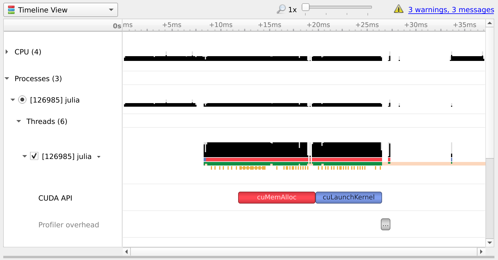
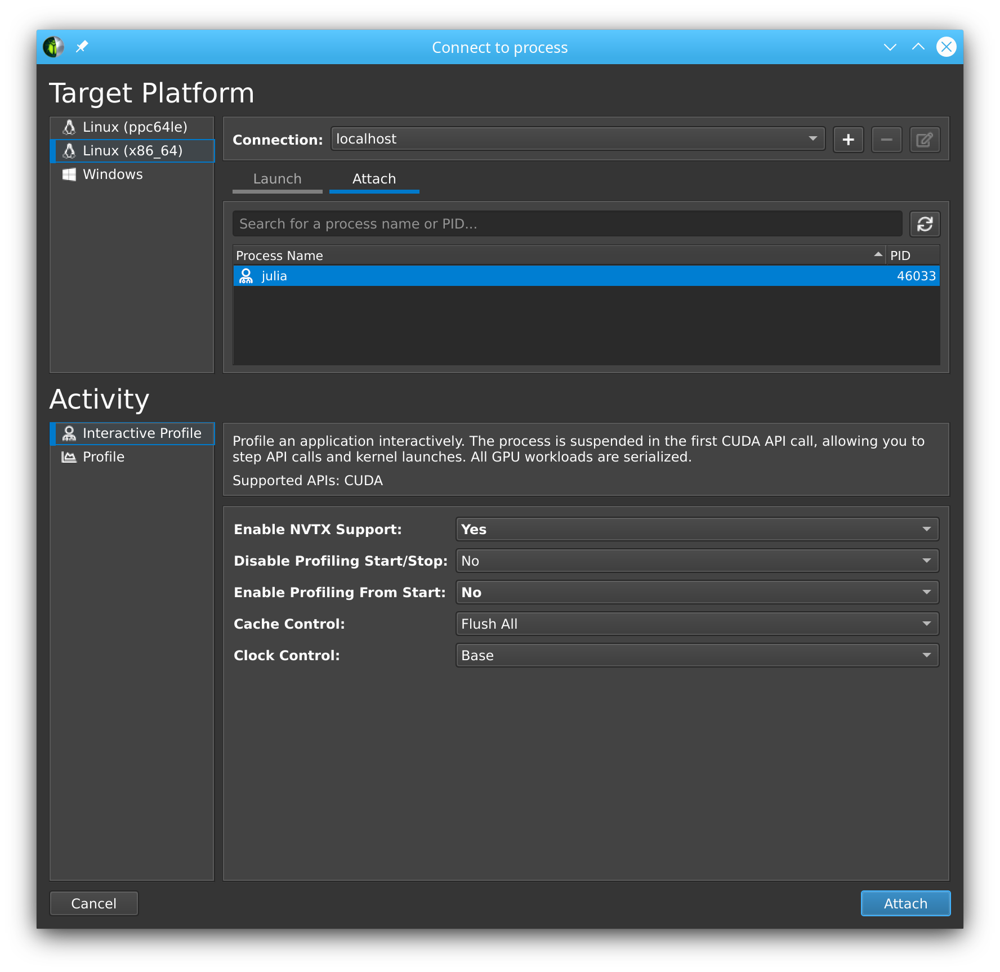
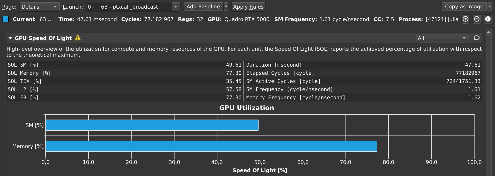
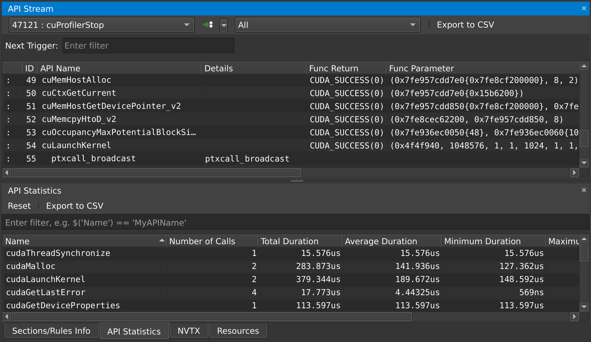

# Benchmarking & profiling

Benchmarking and profiling a GPU program is harder than doing the same for a program
executing on the CPU. For one, GPU operations typically execute asynchronously, and thus
require appropriate synchronization when measuring their execution time. Furthermore,
because the program executes on a different processor, it is much harder to know what is
currently executing. CUDA, and the Julia CUDA packages, provide several tools and APIs to
remedy this.


## Time measurements

To accurately measure execution time in the presence of asynchronously-executing GPU
operations, CUDA.jl provides an `@elapsed` macro that, much like `Base.@elapsed`, measures
the total execution time of a block of code on the GPU:

```julia
julia> a = CUDA.rand(1024,1024,1024);

julia> Base.@elapsed sin.(a)  # WRONG!
0.008714211

julia> CUDA.@elapsed sin.(a)
0.051607586f0
```

This is a low-level utility, and measures time by submitting events to the GPU and measuring
the time between them. As such, if the GPU was not idle in the first place, you may not get
the expected result. The macro is mainly useful if your application needs to know about the
time it took to complete certain GPU operations.

For more convenient time reporting, you can use the `CUDA.@time` macro which mimics
`Base.@time` by printing execution times as well as memory allocation stats, while making
sure the GPU is idle before starting the measurement, as well as waiting for all
asynchronous operations to complete:

```julia
julia> a = CUDA.rand(1024,1024,1024);

julia> CUDA.@time sin.(a);
  0.046063 seconds (96 CPU allocations: 3.750 KiB) (1 GPU allocation: 4.000 GiB, 14.33% gc time of which 99.89% spent allocating)
```

The `CUDA.@time` macro is more user-friendly and is a generally more useful tool when
measuring the end-to-end performance characteristics of a GPU application.

For robust measurements however, it is advised to use the
[BenchmarkTools.jl](https://github.com/JuliaCI/BenchmarkTools.jl) package which goes to
great lengths to perform accurate measurements. Due to the asynchronous nature of GPUs, you
need to ensure the GPU is synchronized at the end of every sample, e.g. by calling
`synchronize()` or, even better, wrapping your code in `CUDA.@sync`:

```julia
julia> a = CUDA.rand(1024,1024,1024);

julia> @benchmark CUDA.@sync sin.($a)
BenchmarkTools.Trial:
  memory estimate:  3.73 KiB
  allocs estimate:  95
  --------------
  minimum time:     46.341 ms (0.00% GC)
  median time:      133.302 ms (0.50% GC)
  mean time:        130.087 ms (0.49% GC)
  maximum time:     153.465 ms (0.43% GC)
  --------------
  samples:          39
  evals/sample:     1
```

Note that the allocations as reported by BenchmarkTools are CPU allocations. For the GPU
allocation behavior you need to consult `CUDA.@time`.


## Application profiling

For profiling large applications, simple timings are insufficient. Instead, we want a
overview of how and when the GPU was active, to avoid times where the device was idle and/or
find which kernels needs optimization.

### Integrated profiler

Once again, we cannot use CPU utilities to profile GPU programs, as they will only paint a
partial picture. Instead, CUDA.jl provides a `CUDA.@profile` macro that separately reports
the time spent on the CPU, and the time spent on the GPU:

```julia
julia> a = CUDA.rand(1024,1024,1024);

julia> CUDA.@profile sin.(a)
Profiler ran for 11.93 ms, capturing 8 events.

Host-side activity: calling CUDA APIs took 437.26 µs (3.67% of the trace)
┌──────────┬───────────┬───────┬───────────┬───────────┬───────────┬─────────────────┐
│ Time (%) │      Time │ Calls │  Avg time │  Min time │  Max time │ Name            │
├──────────┼───────────┼───────┼───────────┼───────────┼───────────┼─────────────────┤
│    3.56% │ 424.15 µs │     1 │ 424.15 µs │ 424.15 µs │ 424.15 µs │ cuLaunchKernel  │
│    0.10% │  11.92 µs │     1 │  11.92 µs │  11.92 µs │  11.92 µs │ cuMemAllocAsync │
└──────────┴───────────┴───────┴───────────┴───────────┴───────────┴─────────────────┘

Device-side activity: GPU was busy for 11.48 ms (96.20% of the trace)
┌──────────┬──────────┬───────┬──────────┬──────────┬──────────┬───────────────────────
│ Time (%) │     Time │ Calls │ Avg time │ Min time │ Max time │ Name                 ⋯
├──────────┼──────────┼───────┼──────────┼──────────┼──────────┼───────────────────────
│   96.20% │ 11.48 ms │     1 │ 11.48 ms │ 11.48 ms │ 11.48 ms │ _Z16broadcast_kernel ⋯
└──────────┴──────────┴───────┴──────────┴──────────┴──────────┴───────────────────────
```

By default, `CUDA.@profile` will provide a summary of host and device activities. If you
prefer a chronological view of the events, you can set the `trace` keyword argument:

```julia
julia> CUDA.@profile trace=true sin.(a)
Profiler ran for 11.71 ms, capturing 8 events.

Host-side activity: calling CUDA APIs took 217.68 µs (1.86% of the trace)
┌────┬──────────┬───────────┬─────────────────┬──────────────────────────┐
│ ID │    Start │      Time │            Name │ Details                  │
├────┼──────────┼───────────┼─────────────────┼──────────────────────────┤
│  2 │  7.39 µs │  14.07 µs │ cuMemAllocAsync │ 4.000 GiB, device memory │
│  6 │ 29.56 µs │ 202.42 µs │  cuLaunchKernel │ -                        │
└────┴──────────┴───────────┴─────────────────┴──────────────────────────┘

Device-side activity: GPU was busy for 11.48 ms (98.01% of the trace)
┌────┬──────────┬──────────┬─────────┬────────┬──────┬─────────────────────────────────
│ ID │    Start │     Time │ Threads │ Blocks │ Regs │ Name                           ⋯
├────┼──────────┼──────────┼─────────┼────────┼──────┼─────────────────────────────────
│  6 │ 229.6 µs │ 11.48 ms │     768 │    284 │   34 │ _Z16broadcast_kernel15CuKernel ⋯
└────┴──────────┴──────────┴─────────┴────────┴──────┴─────────────────────────────────
```

Here, every call is prefixed with an ID, which can be used to correlate host and device
events. For example, here we can see that the host-side `cuLaunchKernel` call with ID 6
corresponds to the device-side `broadcast` kernel.

Integrated profiling requires CUPTI 11 or later. CUPTI 10 can crash when profiling
kernels that use dynamic parallelism; use an external profiler with older toolkits.

#### Kernel metrics

CUDA.jl can also collect hardware metrics for every kernel, which help to understand why
a kernel is slow. By default, `CUDA.@metrics` shows how close each kernel comes to the peak
throughput of the GPU's compute units and memory subsystems, similar to the "speed of
light" section of Nsight Compute:

```julia
julia> a = CUDA.rand(1024,1024,1024);

julia> CUDA.@metrics sin.(a)
Collected hardware metrics for 1 kernel launch on NVIDIA GeForce RTX 5080, executing each kernel 8 times.
Kernels were serialized, so these metrics describe each kernel in isolation.

┌──────────┬───────┬──────────┬─────────┬────────┬───────┬───────┬────────┬─────────────────────────
│ Time (%) │ Calls │ Avg time │ Compute │ Memory │  DRAM │    L2 │ L1/TEX │ Name                   ⋯
├──────────┼───────┼──────────┼─────────┼────────┼───────┼───────┼────────┼─────────────────────────
│  100.00% │     1 │ 11.78 ms │   37.7% │  77.3% │ 77.3% │ 18.3% │  15.5% │ gpu_broadcast_kernel_c ⋯
└──────────┴───────┴──────────┴─────────┴────────┴───────┴───────┴────────┴─────────────────────────
                                                                                    1 column omitted
Throughput is relative to the peak sustained rate of each unit during the kernel's
execution (or the cycles the SMs were active, for L1/TEX). Values of at least 80% are shown in bold.
```

Here, the kernel uses three quarters of the available DRAM bandwidth, but much less of
the SMs' compute throughput, so it is limited by memory accesses rather than by
computation. A kernel where neither compute nor memory throughput comes close to the
peak is typically limited by latency, e.g., because there are not enough threads to hide
it.

Other metrics can be selected with the `metrics` keyword: `metrics=:memory` reports
the amount of DRAM traffic, while a vector of strings collects specific CUPTI metrics.
Use `ncu --query-metrics` to list the metrics your GPU supports. As with the activity
profiler, `trace=true` shows each launch separately instead of summarizing per kernel.
The results can also be used programmatically:

```julia
julia> p = CUDA.@metrics metrics=["dram__bytes.sum"] sin.(a);

julia> p.values
1×1 Matrix{Float64}:
 8.622541568e9
```

To collect these metrics, CUDA.jl executes kernels one at a time, and replays every
kernel as many times as needed to read all counters, restoring the contents of memory
in between. This slows down execution considerably, and means that the metrics describe
each kernel in isolation, not how kernels overlap in your application. Only kernels
launched in the current context are profiled, at most 512 of them, and kernels launched
by CUDA graphs are not supported.

Collecting hardware metrics requires CUDA 12.6 Update 2 or later, except for CUDA 12.8
to 13.1, whose profiler does not work. The NVIDIA driver also restricts access to
performance counters to administrators by default. See [Troubleshooting Nsight
Compute](@ref) for how to lift this restriction.

#### Source-level sampling

To find out *where* in a kernel time goes, `CUDA.@sample` periodically samples which
instruction the warps on every SM are executing, and why they are stalled. Like
`Profile.print`, the result shows a tree of source locations for every sampled function.
As Julia inlines almost all code into GPU kernels, the children of a location are the
functions that were inlined into it:

```julia
julia> a = CUDA.rand(Float32, 2^26); b = similar(a);

julia> CUDA.@sample b .= sin.(a)
gpu_broadcast_kernel_linear(CompilerMetadata<DynamicSize, DynamicCheck, void, CartesianIndi…
9291 samples, 7586 stalled (82%): memory 93%, execution 3%, throttle 2%, issue 2%

Samples  Stalled  Self  File:Line  Function  [Stall reasons]
────────────────────────────────────────────────────────────
   8704     7269   294  @GPUArrays/src/host/broadcast.jl:62  macro expansion  [long_scoreboard…
   8343     7029     0  └─ @Base/broadcast.jl:616  getindex  [long_scoreboard 95%, short_scor…
   8343     7029     0    └─ @Base/broadcast.jl:620  _getindex  [long_scoreboard 95%, short_s…
   8010     6884     0      ├─ @Base/broadcast.jl:672  _broadcast_getindex  [long_scoreboard…
   8010     6884     0      │ └─ @Base/broadcast.jl:699  _broadcast_getindex_evalf  [long_sc…
   7741     6782  7741      │   ├─ CUDACore/src/device/intrinsics/math.jl:30  sin  [long_sco…
    269      102   269      │   └─ CUDACore/src/device/intrinsics/math.jl:32  sin  [wait 50%…
    333      145     0      └─ @Base/broadcast.jl:671  _broadcast_getindex  [short_scoreboa…
...
    528      306   528  ?  (unknown location)  [mio_throttle 38%, wait 28%, short_scoreboard…

Total samples: 9291, sampling every 2^14 cycles per SM on NVIDIA GeForce RTX 5080.
...
```

Every function starts with its name, its number of samples and how many of them were
stalled, broken down by the kind of stall (see below). Every row then lists:

- `Samples`: the samples of the code generated for the location, including the code
  inlined into it;
- `Stalled`: how many of those samples were stalled. A sample is stalled when the warp's
  scheduler couldn't issue any instruction, i.e., when the latency wasn't hidden by other
  warps;
- `Self`: the samples of the location's own code, excluding the functions inlined into
  it (what `Profile.print` calls the overhead);
- the location as `file:line` and the name of the function, followed by the most common
  reasons for the stalls, as a share of the location's stalled samples.

The stall reasons are those of [Nsight
Compute](https://docs.nvidia.com/nsight-compute/ProfilingGuide/index.html#warp-scheduler-states),
which `CUDA.@sample` groups into kinds:

| Kind        | Stall reasons                                               | Warps wait for                                |
|:------------|:------------------------------------------------------------|:----------------------------------------------|
| `memory`    | `long_scoreboard`, `short_scoreboard`, `imc_miss`, `drain`  | the results of memory accesses, or of other variable-latency units (`short_scoreboard` also covers shared memory and special math functions like `sin`'s `MUFU` instructions) |
| `throttle`  | `lg_throttle`, `mio_throttle`, `tex_throttle`, `math_pipe_throttle` | a full memory queue or a busy pipeline    |
| `sync`      | `barrier`, `membar`, `sleeping`                             | other threads, or memory barriers             |
| `execution` | `wait`                                                      | the fixed latency of an earlier instruction   |
| `issue`     | `no_instructions`, `branch_resolving`, `dispatch_stall`, `not_selected`, `selected` | instruction fetch, branches, or the scheduler |

Other reasons are shown as `other`. Stalls are attributed to the instruction that waits,
which often is not the one causing the wait: above, the time spent waiting for `a` to be
loaded shows up in `sin`, which uses the loaded value.

Locations with few samples are hidden: as with `Profile.print`, the `noisefloor` keyword
hides locations with `n <= noisefloor * √N` samples, where `N` is the number of samples of
their parent (2 by default). `format=:flat` lists every location once instead of the
tree, with the same columns, sorted by their number of stalled samples:

```julia
julia> CUDA.@sample format=:flat b .= sin.(a)
gpu_broadcast_kernel_linear(CompilerMetadata<DynamicSize, DynamicCheck, void, CartesianIndi…
9037 samples, 7283 stalled (81%): memory 93%, execution 4%, throttle 2%, issue 1%

Samples  Stalled  Self  File:Line  Function  [Stall reasons]
────────────────────────────────────────────────────────────
   8463     6958   278  @GPUArrays/src/host/broadcast.jl:62  macro expansion  [long_scoreboard…
   8133     6753     0  @Base/broadcast.jl:620  _getindex  [long_scoreboard 95%, short_scorebo…
...
   7522     6497  7522  CUDACore/src/device/intrinsics/math.jl:30  sin  [long_scoreboard 98%…
...
```

To see the samples of every SASS instruction, use `CUDATools.code_sass(p)`. Every sampled
instruction is preceded by its samples, stalled samples and most common stall reason, and
the source locations the code was generated from are shown as comments, indented by how
deeply they were inlined:

```julia
julia> p = CUDA.@sample b .= sin.(a);

julia> CUDATools.code_sass(p)
// gpu_broadcast_kernel_linear(...)
// 9291 samples, 7586 stalled (82%): memory 93%, execution 3%, throttle 2%, issue 2%
// Samples  Stalled  Stall reason
        41       31  no_instructions 55%     /*0000*/ LDC R1, c[0x0][0x37c]
         5        0                          /*0010*/ S2R R2, SR_TID.X
...
        15        3  wait 100%               /*0110*/ LDG.E R0, desc[UR4][R8.64+-0x4]
                                             ;    @Base/broadcast.jl:672  _broadcast_getindex
                                             ;     @Base/broadcast.jl:699  _broadcast_getindex_evalf
                                             ;      CUDACore/src/device/intrinsics/math.jl:30  sin
         3        0                          /*0120*/ BSSY.RECONVERGENT B0, `(.L_x_0)
      7516     6668  long_scoreboard 100%    /*0130*/ FMUL R6, R0.reuse, 0.63661974668502807617
...
```

`CUDATools.code_ptx(p)` does the same for the PTX code that the SASS was generated from.
`ptxas` embeds this code in the cubin, together with a table mapping every SASS
instruction to a line of it (the same data Nsight Compute uses to correlate PTX and SASS),
so every line shows the exact total of the instructions generated for it, without
recompiling anything. The code of functions that `ptxas` inlined is shown as well:

```julia
julia> CUDATools.code_ptx(p)
// gpu_broadcast_kernel_linear(...)
// 9052 samples, 7256 stalled (80%): memory 94%, execution 3%, throttle 2%, issue 1%
// Samples  Stalled  Stall reason
...
       128       60  short_scoreboard 92%    add.s64 	%rd8, %rd3, %rd7;
        14        7  wait 100%               ld.global.b32 	%r4, [%rd8+-4];
                                             //    @Base/broadcast.jl:677  _broadcast_getindex
                                             //     @Base/broadcast.jl:704  _broadcast_getindex_evalf
                                             //      CUDACore/src/device/intrinsics/math.jl:30  sin
      7372     6406  long_scoreboard 100%    mul.f32 	%r13, %r4, 0f3F22F983;
        23        6  wait 100%               cvt.rni.s32.f32 	%r73, %r13;
...
```

The source locations in this view are those of the first SASS instruction generated for a
line. Both functions take `debuginfo=:none` to leave them out, and `code_ptx` takes
`raw=true` to print the code as embedded, including the empty lines that replace
directives like `.loc`. The PTX code is only available for code compiled with line
information, i.e., with a debug level of at least 1 (the default).

In a terminal that supports colors, the number of stalled samples, the stall reasons and
the kinds in the summary are colored by kind of stall (`memory` in red, `throttle` in
yellow, `sync` in magenta, `execution` in blue, `issue` in cyan), source paths and tree
guides are dimmed, and hot code (locations or instructions with at least 10% of their
function's samples) is shown in bold. When the output is not a terminal, for example when
it is written to a file or captured with `string(p)`, the text is the same but without
colors, and lines are never cropped, so every row can be found with tools like `grep`.
The JSON output described below contains the same information in a structured form.

All kernels that execute in the current context are sampled, at nearly full speed and
concurrently. The program counter of a warp on every SM is sampled once every
`2^period` cycles (`period=14` by default); shorter periods collect more samples, which
take longer to process. Sampling requires CUDA 13 or later, a GPU with compute capability
7.5 or higher, and access to the performance counters (see [Troubleshooting Nsight
Compute](@ref)).

Source locations come from the line tables that `ptxas` generates. These sometimes
attribute instructions to the wrong inlined function, and code without line information
is shown as an unknown location.

#### Machine-readable output

The results of `CUDA.@profile`, `CUDA.@metrics` and `CUDA.@sample` can also be written as JSON, which is
easier to process for scripts and coding agents:

```julia
julia> p = CUDA.@profile sin.(a);

julia> show(stdout, "application/json", p)
{"schema_version":1,"view":"summary","raw":false,"duration_ns":3.28700542e7,"events":8,...

julia> p = CUDA.@sample b .= sin.(a);

julia> show(stdout, "application/json", p)
{"schema_version":1,"view":"tree","device":"NVIDIA GeForce RTX 5080","period":14,...,
 "frames":[{"function":"macro expansion","file":".../GPUArrays/3gHjC/src/host/broadcast.jl","line":62},...],
 "ptx":["\u000a\u000a\u000a\u000a.version 9.4\u000a.target sm_120a\u000a...",...],
 "functions":[{"name":"gpu_broadcast_kernel_linear(...)",...,"count":9291,"stalled":7586,"ptx":0,
               "locations":[{"depth":0,"frame":0,"count":8704,"stalled":7269,"overhead":294,
                             "reasons":{"branch_resolving":88,"drain":153,"long_scoreboard":6668,...}},...],
               "instructions":[{"offset":"0x0000","sass":"LDC R1, c[0x0][0x37c]","frames":[],"ptx_line":17,
                                "count":{"mio_throttle":17,...},"stalled":{...}},...]}]}
```

The JSON contains the same report as the tables, as selected by the `trace` and `raw`
keyword arguments, with times in nanoseconds and untruncated kernel names. For
`CUDA.@sample`, it contains the rows of the tree or flat view (`locations`, with their
`depth` and an index into the shared `frames`), and every sampled instruction with its
samples per stall reason and the line of PTX code it was generated from, which indexes the
PTX code of its module (`ptx`); stall kinds are not included, as they follow from the
reasons. See
[`Profile.ProfileResults`](@ref CUDATools.Profile.ProfileResults),
[`Profile.KernelProfile`](@ref CUDATools.Profile.KernelProfile) and
[`Profile.PCProfile`](@ref CUDATools.Profile.PCProfile) for a description of the
contents.

#### Profiling on Tegra

The integrated profiler relies on CUPTI, which needs additional permissions on Tegra
devices (such as the Jetson series). What exactly is required depends on the CUDA version:

- with CUDA 13 and later (typically JetPack 7+), non-root users need read/write access to
  the GPU profiling device nodes `/dev/nvgpu/*/prof*`. These are commonly owned by the
  `debug` group on Jetson systems, in which case run `sudo usermod -aG debug $USER` and
  log in again. The driver also needs to allow non-admin profiling by loading `nvidia` with
  `NVreg_RestrictProfilingToAdminUsers=0` (see [Troubleshooting Nsight Compute](@ref)
  below). Without the device node access, CUPTI crashes the process outright instead
  of reporting an error;
- with CUDA 10 through 12 (typically JetPack 4 through 6), profiling requires running as
  root. Membership of the `debug` group is not enough there: on an AGX Xavier with
  read/write access to `/dev/nvgpu/igpu0/prof`, CUPTI 11.8 still refuses every activity
  kind with `CUPTI_ERROR_INSUFFICIENT_PRIVILEGES`. Verified with CUDA 10.2, 11.4 and
  11.8; CUDA 12 uses the same conservative gate.

The same requirements apply to other CUPTI-based functionality, such as
`@device_code_sass`.

Some optional trace records are unavailable on older Tegra toolkits. CUDA.jl skips
unsupported NVTX marker-data records and checks CUPTI's own API version before enabling
memory-allocation records. In particular, JetPack 5's local CUDA 11.4 installation ships
an older CUPTI, so its integrated profiles omit memory-allocation records.

### External profilers

If you want more details, or a graphical representation, we recommend using external
profilers. To inform those external tools which code needs to be profiled (e.g., to exclude
warm-up iterations or other noninteresting elements) you can also use `CUDA.@profile` to
surround interesting code with:

```julia
julia> a = CUDA.rand(1024,1024,1024);

julia> sin.(a);  # warmup

julia> CUDA.@profile sin.(a);
[ Info: This Julia session is already being profiled; defaulting to the external profiler.

julia>
```

Note that the external profiler is automatically detected, and makes `CUDA.@profile` switch
to a mode where it merely activates an external profiler and does not do perform any
profiling itself. In case the detection does not work, this mode can be forcibly activated
by passing `external=true` to `CUDA.@profile`.

NVIDIA provides two tools for profiling CUDA applications: Nsight Systems and Nsight Compute
for respectively timeline profiling and more detailed kernel analysis. Both tools are
well-integrated with the Julia GPU packages, and make it possible to iteratively profile
without having to restart Julia.

#### NVIDIA Nsight Systems

Generally speaking, the first external profiler you should use is [Nsight
Systems](https://developer.nvidia.com/nsight-systems), as it will give you a
high-level overview of your application's performance characteristics. After
downloading and installing the tool (a version might have been installed
alongside with the CUDA toolkit, but it is recommended to download and install
the latest version from the NVIDIA website), you need to launch Julia from the
command-line, wrapped by the `nsys` utility from Nsight Systems:

```
$ nsys launch julia
```

You can then execute whatever code you want in the REPL, including e.g. loading Revise so
that you can modify your application as you go. When you call into code that is wrapped by
`CUDA.@profile`, the profiler will become active and generate a profile output file in
the current folder:

```julia
julia> using CUDA

julia> a = CUDA.rand(1024,1024,1024);

julia> sin.(a);

julia> CUDA.@profile sin.(a);
start executed
Processing events...
Capturing symbol files...
Saving intermediate "report.qdstrm" file to disk...

Importing [===============================================================100%]
Saved report file to "report.qdrep"
stop executed
```

!!! note

    Even with a warm-up iteration, the first kernel or API call might seem to take
    significantly longer in the profiler. If you are analyzing short executions, instead
    of whole applications, repeat the operation twice (optionally separated by a call to
    `synchronize()` or wrapping in `CUDA.@sync`)

You can open the resulting `.qdrep` file with `nsight-sys`:



!!! info

    If Nsight Systems does not capture any kernel launch, even though you have used
    `CUDA.@profile`, try starting `nsys` with `--trace cuda`.

#### NVIDIA Nsight Compute

If you want details on the execution properties of a single kernel, or inspect
API interactions in detail, [Nsight
Compute](https://developer.nvidia.com/nsight-compute) is the tool for you. It is
again possible to use this profiler with an interactive session of Julia, and
debug or profile only those sections of your application that are marked with
`CUDA.@profile`.

First, ensure that all (CUDA) packages that are involved in your application have been
precompiled. Otherwise, you'll end up profiling the precompilation process, instead of
the process where the actual work happens.

Then, launch Julia under the Nsight Compute CLI tool as follows:

```
$ ncu --mode=launch julia
```

You will get an interactive REPL, where you can execute whatever code you want:

```julia
julia> using CUDA
# Julia hangs!
```

As soon as you use CUDA.jl, your Julia process will hang. This is expected, as the tool
breaks upon the very first call to the CUDA API, at which point you are expected to launch
the Nsight Compute GUI utility, select `Interactive Profile` under `Activity`, and attach
to the running session by selecting it in the list in the `Attach` pane:



Note that this even works with remote systems, i.e., you can have Nsight Compute connect
over ssh to a remote system where you run Julia under `ncu`. (If allowed by the remote system administrator, see  [the NVIDIA documentation issue webpage](https://developer.nvidia.com/ERR_NVGPUCTRPERM) for more details.  )

Once you've successfully attached to a Julia process, you will see that the tool has stopped
execution on the call to `cuInit`. Now check `Profile > Auto Profile` to make Nsight Compute
gather statistics on our kernels, uncheck `Debug > Break On API Error` to avoid halting the
process when innocuous errors happen, and click `Debug > Resume` to resume your application.

After doing so, our CLI session comes to life again, and we can execute the rest of our script:

```julia
julia> a = CUDA.rand(1024,1024,1024);

julia> sin.(a);

julia> CUDA.@profile sin.(a);
```

Once that's finished, the Nsight Compute GUI window will have plenty details on our kernel:



By default, this only collects a basic set of metrics. If you need more information on a
specific kernel, select `detailed` or `full` in the `Metric Selection` pane and re-run
your kernels. Note that collecting more metrics is also more expensive, sometimes even
requiring multiple executions of your kernel. As such, it is recommended to only collect
basic metrics by default, and only detailed or full metrics for kernels of interest.

At any point in time, you can also pause your application from the debug menu, and inspect
the API calls that have been made:



Note that command line execution of Julia scripts also works. Run `ncu julia myscript.jl` without `--mode=launch` to profile the entire script. Use the `ncu` command line arguments if desired. Refer to [the NVIDIA documentation](https://docs.nvidia.com/nsight-compute/NsightComputeCli/index.html) for more details.

#### Troubleshooting Nsight Compute

If you're running into issues, make sure you're using the same version of Nsight Compute on
the host and the device, and make sure it's the latest version available. You do not need
administrative permissions to install Nsight Compute, the `runfile` downloaded from the
NVIDIA home page can be executed as a regular user.

##### Kernel sources only report `File not found`

When profiling a remote application, Nsight Compute will not be able to find the sources of
kernels, and instead show `File not found` errors in the Source view. Although it is
possible to point Nsight Compute to a local version of the remote file, it is recommended
to enable "Auto-Resolve Remote Source File" in the global Profile preferences (Tools menu
-> Preferences). With that option set to "Yes", clicking the "Resolve" button will
automatically download and use the remote version of the requested source file.

##### `Could not load library "libpcre2-8`

This is caused by an incompatibility between Julia and Nsight Compute, and should be fixed
in the latest versions of Nsight Compute. If it's not possible to upgrade, the following
workaround may help:

```
LD_LIBRARY_PATH=$(/path/to/julia -e 'println(joinpath(Sys.BINDIR, Base.LIBDIR, "julia"))') ncu --mode=launch /path/to/julia
```

##### The Julia process is not listed in the "Attach" tab

Make sure that the port that is used by Nsight Compute (49152 by default) is accessible via
ssh. To verify this, you can also try forwarding the port manually:

```
ssh user@host.com -L 49152:localhost:49152
```

Then, in the "Connect to process" window of Nsight Compute, add a connection to `localhost`
instead of the remote host.

If SSH complains with `Address already in use`, that means the port is already in use. If
you're using VSCode, try closing all instances as VSCode might automatically forward the
port when launching Nsight Compute in a terminal within VSCode.

##### Julia in Nsight Compute only shows the Julia logo, not the REPL prompt

In some versions of Nsight Compute, you might have to start Julia without the `--project`
option and switch the environment from inside Julia.

##### "Disconnected from the application" once I click "Resume"

Make sure that everything is precompiled before starting Julia with Nsight Compute,
otherwise you end up profiling the precompilation process instead of your actual
application.

Alternatively, disable auto profiling, resume, wait until the precompilation is finished,
and then enable auto profiling again.

##### I only see the "API Stream" tab and no tab with details on my kernel on the right

Scroll down in the "API Stream" tab and look for errors in the "Details" column.
If it says "The user does not have permission to access NVIDIA GPU Performance Counters
on the target device", add this config:

```
# cat /etc/modprobe.d/nvprof.conf
options nvidia NVreg_RestrictProfilingToAdminUsers=0
```

The `nvidia.ko` kernel module needs to be reloaded after changing this configuration, and
your system may require regenerating the initramfs or even a reboot. Refer to your
distribution's documentation for details.

##### Nsight Compute breaks on various API calls

Make sure `Break On API Error` is disabled in the `Debug` menu, as CUDA.jl purposefully
triggers some API errors as part of its normal operation.

##### NaN values as output in NSight Compute.

Incompatibility between the ncu and Julia CUDA version. Run `ncu --version` to find which CUDA toolkit is being used. In Julia set `CUDA.set_runtime_version!(v"xx.x")` to the same version. This version may be lower than the driver version output in `nvidia-smi`, but not higher.

##### "Profiling is not supported on this device" error

Nsight Compute does not support the GPU you have. Run `ncu --list-chips` to verify. Either delete newer versions of CUDA Toolkit and set the environment variable `CUDA_PATH` to a previous version, or install a newer version.

##### `==ERROR== ERR_NVGPUCTRPERM`

Run the terminal as administrator. Refer to [the NVIDIA documentation issue webpage](https://developer.nvidia.com/ERR_NVGPUCTRPERM) for more details.
On Tegra devices, also see [Profiling on Tegra](@ref) for the additional device node
permissions required there.

##### `==ERROR== Cuda driver is not compatible with Nsight Compute`

As the error message suggests, the version of Nsight Compute you are using may be too new for the driver installed on the machine where you are trying to run the GPU application.
If possible and if it is compatible with your GPU, upgrade the CUDA driver on the target machine, otherwise downgrade Nsight Compute to a version which supports the CUDA driver installed on the system.

##### `CUDA error: device kernel image is invalid (code 200, ERROR_INVALID_IMAGE)`

First of all, make sure your application works normally outside the profiler.
If you only get this error while running Julia under Nsight Compute, the problem may be a mismatch between the CUDA toolkit used by the profiler and the one loaded by Julia.
In that case, try pointing CUDA.jl to a [local CUDA toolkit](@ref "Using a local CUDA").

## Source-code annotations

If you want to put additional information in the profile, e.g. phases of your application,
or expensive CPU operations, you can use the NVTX library via the NVTX.jl package:

```julia
using CUDA, NVTX

NVTX.@mark "reached Y"

NVTX.@range "doing X" begin
    ...
end

NVTX.@annotate function foo()
    ...
end
```

For more details, refer to the documentation of the NVTX.jl package.


## Compiler options

Some tools, like Nsight Systems Compute, also make it possible to do source-level profiling.
CUDA.jl will by default emit the necessary source line information, which you can disable by
launching Julia with `-g0`. Conversely, launching with `-g2` will emit additional debug
information, which can be useful in combination with tools like `cuda-gdb`, but might hurt
performance or code size.
